# Informe de funcionamiento: robots y controles

Este informe explica cómo funciona el sistema de los tres robots de fútbol: qué hace cada placa, cómo se comunican, cómo se arma y se detiene un robot y qué protecciones tiene. Describe el firmware tal como está en la rama `main`. Los detalles de cableado, lista de materiales y configuración están en el [README](../README.md).

**Estado de las pruebas (23-nov-2026):** el par 3 se probó en banco (control CYD + ESP32 sin motores) y el par 1 tuvo una prueba improvisada en el colegio, informada por el equipo (fuente de laptop, L298N, motorreductores y `control_tx` con LCD y joystick), sin mediciones registradas. Lo que aquí se describe es el comportamiento del código; las cifras de tiempo son las programadas, no medidas en los robots.

---

## 1. Visión general

El equipo tiene **3 pares** control/robot. Cada par es independiente: el control *n* solo habla con el robot *n*.

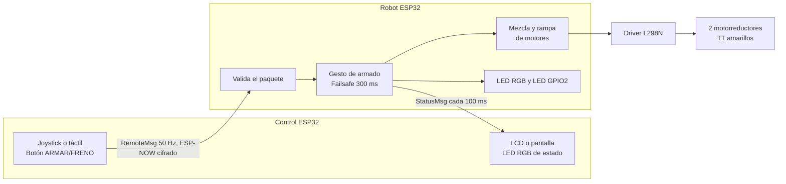

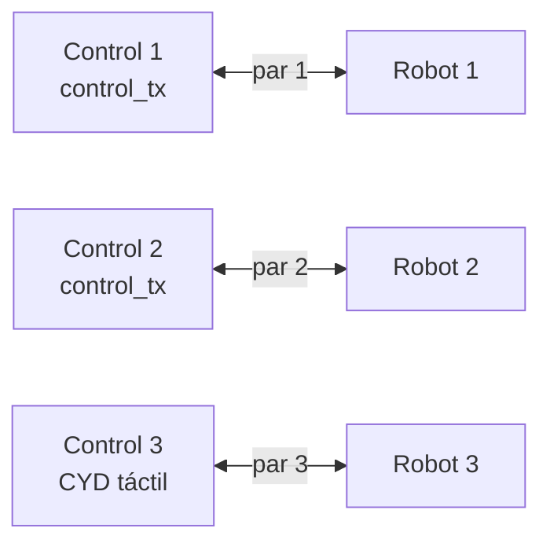

| Programa | Placa | Función |
| :--- | :--- | :--- |
| `control_tx/control_tx.ino` | ESP32 DevKit + joystick KY-023 + LCD 16x2 I2C + LED RGB | Control físico (pares 1 y 2) |
| `control_cyd/control_cyd.ino` | CYD ESP32-2432S024 (pantalla táctil de 2,4") | Control táctil (par 3) |
| `robot_rx/robot_rx.ino` | ESP32 DevKit + driver L298N + 2 motorreductores TT amarillos | Robot |
| `get_mac/get_mac.ino` | Cualquier ESP32 | Leer la MAC de una placa para configurarla |
| `tools/cyd_probe/` | CYD | Diagnóstico de hardware de la CYD (no es firmware del juego) |

Los tres programas principales comparten el mismo formato de mensajes (`soccer_protocol.h`) y la misma configuración de pares (`team_config.h`).

---

## 2. Comunicación por radio (ESP-NOW)

### 2.1 Por qué ESP-NOW

ESP-NOW es un protocolo de Espressif que envía paquetes cortos directamente entre ESP32, **sin router ni WiFi**. Tiene poca latencia y no necesita conectarse a una red, por eso funciona igual en el colegio que en la sede de la competencia.

### 2.2 Emparejamiento y cifrado

Cada par se define en `team_config.h` (archivo privado, **no** se sube a GitHub) con:

- **MAC del control y MAC del robot.** Cada placa comprueba al arrancar que su propia MAC coincide con la esperada; si no, se detiene con error (LED rojo parpadeando). Así no se puede cargar por error el firmware del par 2 en el robot 1.
- **Claves PMK y LMK** (16 bytes cada una). ESP-NOW cifra cada paquete con ellas. Un ESP32 ajeno, aunque esté en el mismo canal, no puede enviar órdenes válidas a nuestros robots.
- **`PAIR_ID`** (1, 2 o 3) indica qué fila del archivo usa cada placa.
- **`WIFI_CHANNEL`** (canal 1 por defecto) debe ser el mismo en control y robot.

### 2.3 Mensajes

Hay dos tipos de mensaje, ambos de tamaño fijo y con un CRC16 para detectar errores:

**`RemoteMsg` (control → robot, 18 bytes, 50 veces por segundo):**

| Campo | Contenido |
| :--- | :--- |
| `magic` | "SOCC", identifica un comando del juego |
| `version` | Versión del protocolo (2). Control y robot deben tener la misma |
| `pairId` | Número de par |
| `flags` | Bit 0 = botón pulsado |
| `seq` | Número de secuencia, siempre creciente |
| `throttle` | Avance/retroceso, de −1000 a +1000 |
| `steering` | Giro, de −1000 (izquierda) a +1000 (derecha) |
| `crc16` | Comprobación de integridad |

**`StatusMsg` (robot → control, 14 bytes, cada 100 ms y al cambiar de estado):** indica el estado del robot (Esperando, Desarmado o Armado) y el último número de secuencia que aceptó.

### 2.4 Qué comprueba el robot en cada paquete

El robot descarta el paquete (sin renovar el failsafe) si falla cualquiera de estas condiciones:

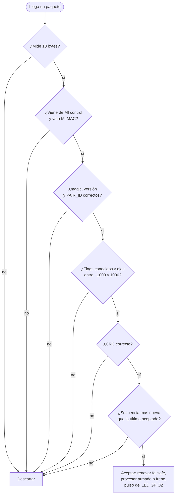

El último paso es la protección **anti-replay**: un paquete grabado y reenviado más tarde se rechaza porque su número ya es viejo. Para que esto funcione aunque el control se reinicie, el control guarda en su memoria no volátil (NVS) el siguiente bloque de 10 000 números **antes** de usarlos. Por eso **nunca hay que borrar la NVS** para "arreglar" una conexión: se perdería esta garantía.

### 2.5 Cómo sabe el control que el robot está conectado

El control **no** se fía de que el envío "salió bien" por radio. Solo muestra Desarmado o Armado cuando recibe un `StatusMsg` válido del robot que confirma uno de sus últimos 32 envíos, hecho hace como máximo 300 ms. Si deja de recibir estados durante más de 300 ms, muestra **Sin señal**.

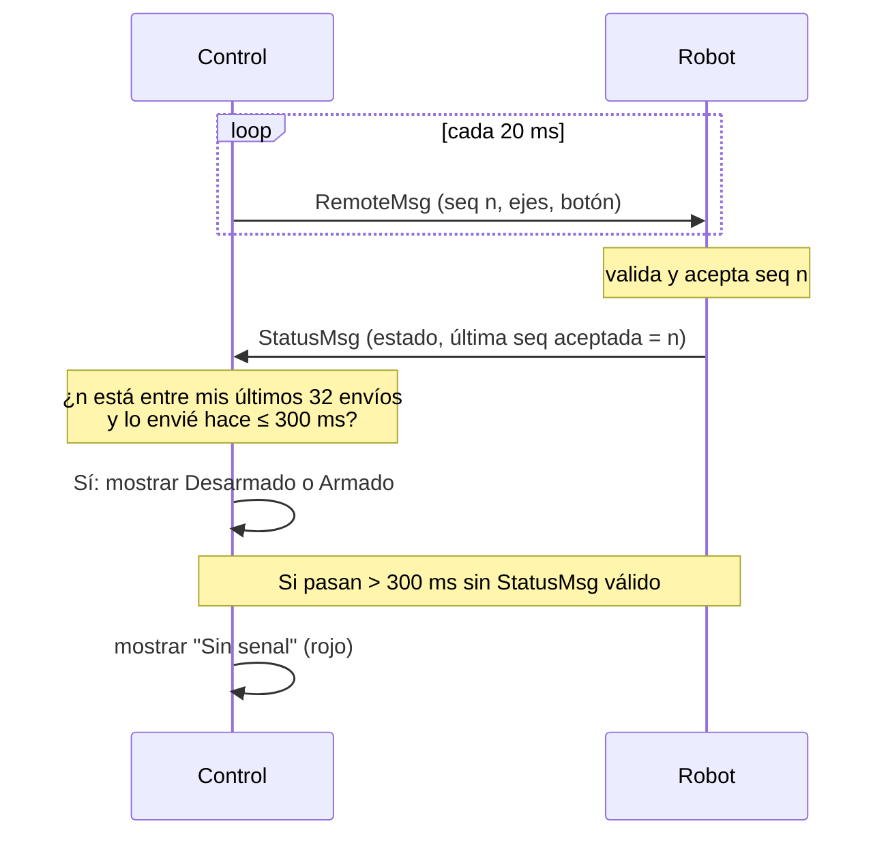

---

## 3. El robot (`robot_rx`)

### 3.1 Estados

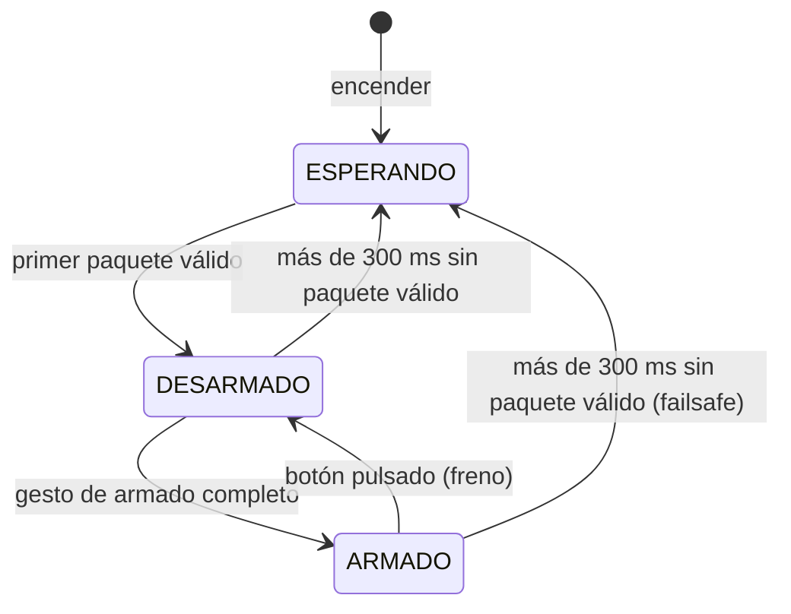

- **Esperando:** no recibe paquetes válidos. Motores frenados.
- **Desarmado:** recibe paquetes, pero no tiene permiso para moverse. Motores frenados.
- **Armado:** los motores siguen el joystick.

### 3.2 Gesto de armado

Para pasar de Desarmado a Armado hay que hacer, sin mover el joystick:

1. Soltar el botón y dejar el joystick **en el centro durante 500 ms**.
2. **Pulsar** el botón.
3. **Soltarlo.** Al soltarlo, el robot queda Armado.

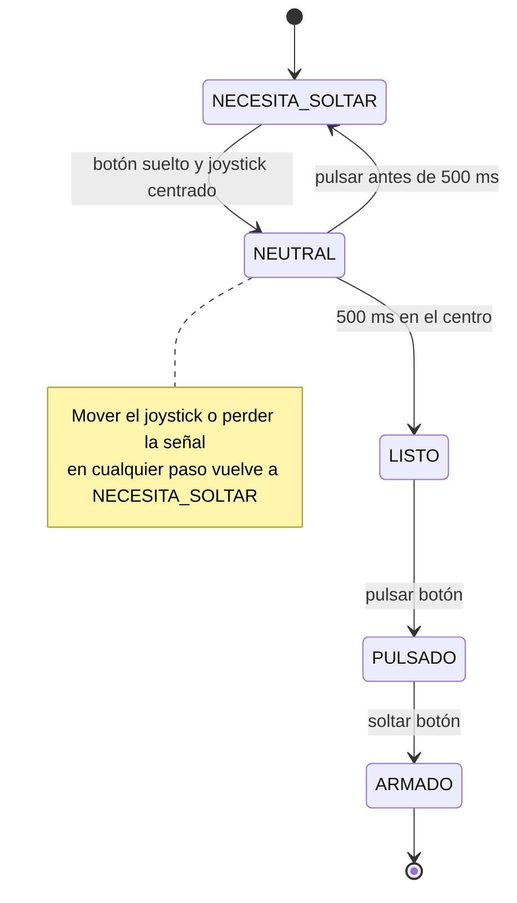

Si durante el gesto se mueve el joystick, se pulsa antes de tiempo o se pierde la señal, el gesto se cancela y hay que empezar de nuevo. Esto evita que el robot arranque solo, por ejemplo al encender el control con el joystick inclinado.

### 3.3 Frenado

El robot frena **de inmediato, sin rampa**, en tres casos:

- **Botón pulsado estando Armado:** el robot frena y queda Desarmado. Para volver a moverse hay que repetir el gesto de armado.
- **Failsafe:** si pasan **más de 300 ms** sin un paquete válido (control apagado, fuera de alcance, interferencia), frena y vuelve a Esperando. Al recuperar la señal queda Desarmado, nunca Armado: hay que rearmar.
- **Error fatal** al arrancar (configuración incorrecta, fallo de radio o de PWM).

El freno es **activo**: el L298N pone ambas salidas del motor a nivel bajo con el puente habilitado, así que el motor se detiene más rápido que dejándolo girar libre.

### 3.4 Del joystick a los motores

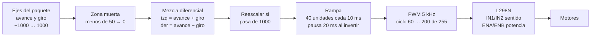

1. **Zona muerta:** valores de eje menores que 50 (de 1000) se toman como cero, para que el robot no se arrastre con el joystick casi centrado.
2. **Mezcla diferencial:** `izquierdo = avance + giro` y `derecho = avance − giro`. Si alguno pasa de 1000, ambos se reescalan en la misma proporción para mantener la dirección.
3. **Rampa:** cada 10 ms cada motor cambia como máximo 40 unidades. De parado a máxima velocidad tarda unos **250 ms**. Esto reduce picos de corriente que podrían reiniciar el ESP32.
4. **Cambio de sentido:** antes de invertir, el motor baja a cero y espera **20 ms** parado. Protege el driver y la caja reductora.
5. **PWM:** la magnitud 1…1000 se convierte en un ciclo de trabajo entre **60 y 200** (de 255) a 5 kHz. El mínimo de 60 vence la fricción de la caja reductora; el máximo de 200 limita el voltaje medio en el motor (los TT amarillos son de 3–6 V y la batería 2S llega a 8,4 V). Estos valores se ajustan en `MOTOR_MIN_DUTY` y `MOTOR_MAX_DUTY` tras medir.
6. Si un motor gira al revés por cómo se cableó, se corrige con `LEFT_MOTOR_REVERSED` o `RIGHT_MOTOR_REVERSED` sin recablear.

### 3.5 Pines del robot

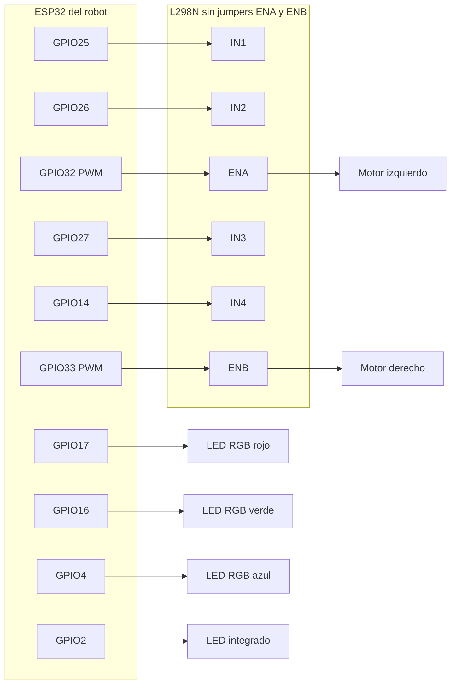

| Función | GPIO |
| :--- | :--- |
| Motor izquierdo IN1 / IN2 / ENA (PWM) | 25 / 26 / 32 |
| Motor derecho IN3 / IN4 / ENB (PWM) | 27 / 14 / 33 |
| LED RGB de estado R / G / B | 17 / 16 / 4 |
| LED integrado (recepción) | 2 |

Los jumpers ENA y ENB del L298N **deben retirarse**; si no, el PWM no tiene efecto.

### 3.6 Indicadores del robot

| LED RGB | Significado |
| :--- | :--- |
| Azul | Arrancando o sin ningún paquete aún |
| Amarillo (rojo + verde) | Paquetes recientes, Desarmado |
| Verde | Armado |
| Rojo | Failsafe: perdió la señal |
| Rojo parpadeando | Error fatal al arrancar (ver monitor serie) |

El **LED integrado (GPIO2)** da un pulso de 8 ms por cada comando aceptado. A 50 Hz se ve como una luz tenue casi fija; si el enlace empeora se ve más débil o intermitente, y sin comandos se apaga.

El LED RGB es opcional para el reglamento actual; el equipo todavía no ha decidido si se monta.

### 3.7 Organización interna del código

El callback de ESP-NOW (lo que se ejecuta al llegar un paquete) solo **valida y copia** datos dentro de una sección crítica. Todo lo lento o con hardware (PWM, LEDs, enviar estados, `Serial`) se hace en `loop()`. Una orden de freno queda guardada (`brakePending`) hasta que `loop()` la atiende, así un pulso corto del botón no se pierde aunque llegue otro paquete justo después.

---

## 4. Control con joystick (`control_tx`)

### 4.1 Arranque y calibración

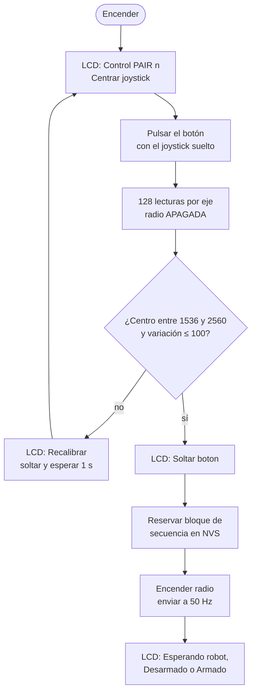

1. Al encender, el LCD muestra **"Control PAIR n"** y **"Centrar joystick"**.
2. Con el joystick suelto en el centro, se **pulsa** el botón del joystick. El control toma 128 lecturas de cada eje.
3. Si el centro está dentro del rango normal (1536–2560 de 4095) y estable (variación ≤ 100), muestra **"Soltar boton"**. Si no, muestra **"Recalibrar"** y hay que repetir.
4. Al soltar el botón se enciende la radio. **Durante la calibración la radio está apagada**: no se envía nada.

Esa pulsación de calibración no cuenta para el gesto de armado.

### 4.2 Funcionamiento normal

- Lee el joystick (promedio de 8 muestras por eje) y envía un `RemoteMsg` cada **20 ms (50 Hz)**.
- El eje Y está invertido por defecto (`INVERT_Y = true`) para que empujar hacia adelante sea avanzar.
- El **botón** del joystick (se pulsa hundiendo la palanca) sirve para armar y para frenar.

### 4.3 Pines del control

| Función | GPIO |
| :--- | :--- |
| Joystick VRx / VRy (ADC1) | 35 / 34 |
| Botón SW (pull-up interno) | 27 |
| LED RGB R / G / B | 25 / 26 / 33 |
| LCD I2C SDA / SCL | 21 / 22 (pines I2C por defecto) |

El joystick y el backpack del LCD se alimentan a **3,3 V**, no a 5 V. El LCD se busca en las direcciones 0x27 y 0x3F; si no aparece, el control sigue funcionando sin pantalla.

### 4.4 Indicadores del control

| LCD | LED RGB | Significado |
| :--- | :--- | :--- |
| Esperando robot | Azul | Nunca recibió confirmación del robot |
| Desarmado | Amarillo | Robot conectado, sin permiso de movimiento |
| Armado | Verde | Robot conectado y armado |
| Sin senal | Rojo | Tenía conexión pero lleva más de 300 ms sin estado del robot |
| ERROR FATAL | Rojo parpadeando | Fallo al arrancar (configuración, radio o NVS) |

---

## 5. Control táctil CYD (`control_cyd`)

Usa **la misma lógica de radio, secuencia y confirmación** que `control_tx`; solo cambia la forma de manejarlo.

### 5.1 Arranque

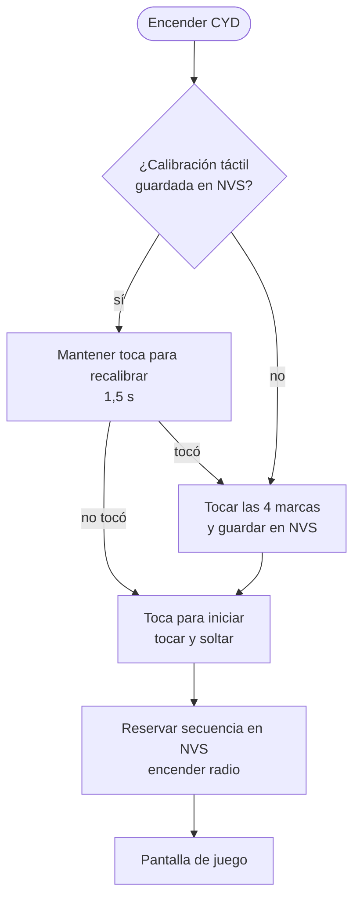

1. Si ya hay calibración táctil guardada, muestra **"Mantener toca para recalibrar"** durante 1,5 s. Tocar la pantalla en ese momento obliga a recalibrar.
2. Sin calibración (o si se pidió), hay que tocar las 4 marcas de las esquinas. La calibración se guarda en NVS (`cyd_ui`), separada del contador anti-replay.
3. **"Toca para iniciar"**: un toque y soltar enciende la radio. Ese toque no cuenta para el armado.

### 5.2 Pantalla de juego

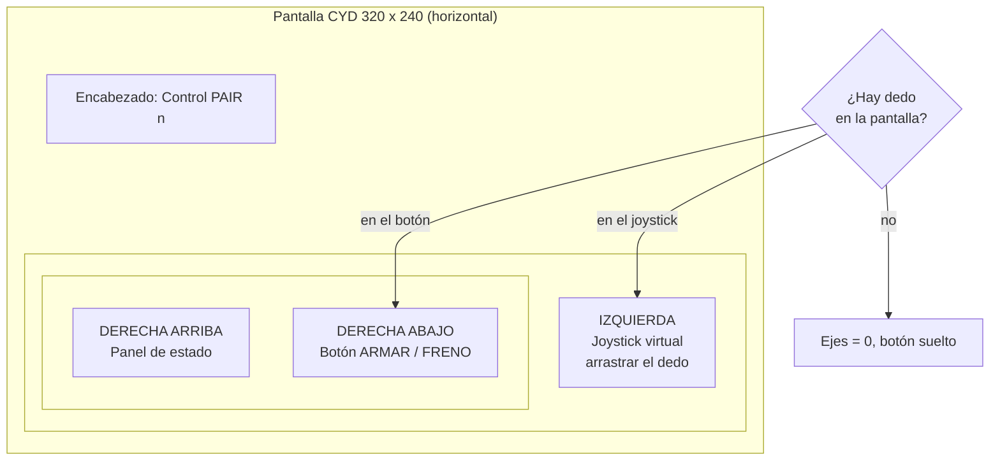

- **Izquierda: joystick virtual.** Se arrastra el dedo dentro del círculo; arriba es avanzar. El desplazamiento se limita al radio del círculo y se escala a ±1000.
- **Derecha arriba: panel de estado** con el mismo texto y color que el LCD del otro control.
- **Derecha abajo: botón ARMAR / FRENO**, equivalente al botón del joystick.
- **Sin dedo en la pantalla, los ejes vuelven a cero** de inmediato.
- El táctil es **resistivo y de un solo toque**: no se puede mover el joystick y pulsar el botón a la vez. Un toque debe empezar dentro de una zona y confirmarse en dos lecturas seguidas antes de usarse.

### 5.3 LED de la CYD

El LED RGB integrado se pone **verde mientras se envía una acción** (joystick fuera del centro o botón pulsado) y el robot confirma el enlace (Desarmado o Armado). Sin acción muestra el color del estado. Con Sin señal o Esperando robot no se fuerza el verde, para no ocultar una pérdida de enlace.

---

## 6. Alimentación del robot (según el README)

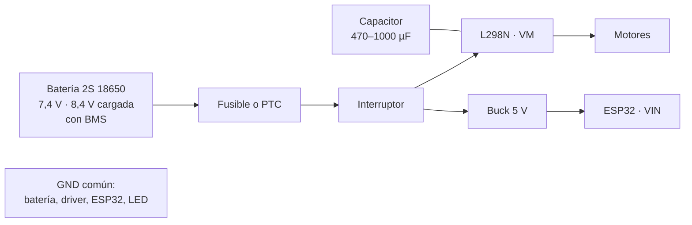

- Batería **2S 18650** (7,4 V nominal, 8,4 V cargada) con BMS de balance.
- Los motores se alimentan desde el L298N; el ESP32 desde un **convertidor buck de 5 V** dedicado. No usar la salida de 5 V del L298N con 2S.
- Capacitor electrolítico de 470–1000 µF entre VM y GND del driver, para evitar reinicios del ESP32 por picos de corriente.
- Tierra común entre batería, driver, LED y ESP32.
- El firmware **no mide la batería**: no hay aviso de batería baja. Hay que medirla con multímetro.

---

## 7. Comportamiento en un partido

| Situación | Qué pasa | Qué hacer |
| :--- | :--- | :--- |
| Encender | Robot azul; control calibra y luego muestra Esperando robot o Desarmado | Calibrar con el joystick suelto |
| Antes del saque | Robot Desarmado (amarillo) | Hacer el gesto de armado: centro 500 ms, pulsar y soltar |
| Pulsar el botón jugando | El robot **frena y se desarma** | Repetir el gesto para seguir (unos 0,5–1 s) |
| Interferencia o control fuera de alcance más de 300 ms | El robot frena; al volver la señal queda Desarmado | Rearmar |
| Choque fuerte que reinicia el robot | Vuelve a Esperando y luego Desarmado | Rearmar; si se repite, revisar alimentación y capacitor |
| Reinicio del control | Hay que recalibrar y rearmar | El contador anti-replay sigue desde la NVS; no borrarla |

**Atención con el control de joystick:** el botón del KY-023 se activa **hundiendo la palanca**. Si el piloto aprieta la palanca hacia abajo mientras conduce, el robot frena y se desarma. Conviene practicarlo.

---

## 8. Parámetros principales

| Parámetro | Valor | Dónde |
| :--- | :--- | :--- |
| Frecuencia de envío de comandos | 50 Hz (20 ms) | `SEND_INTERVAL_US` en los controles |
| Failsafe del robot | 300 ms | `FAILSAFE_TIMEOUT_MS` en `robot_rx` |
| Timeout de estado en el control | 300 ms | `STATUS_TIMEOUT_MS` en los controles |
| Neutral previo al armado | 500 ms | `ARM_NEUTRAL_MS` en `robot_rx` |
| Zona muerta | 50 de 1000 | `COMMAND_DEADZONE`, `JOYSTICK_DEADZONE` |
| Rampa | 40 unidades cada 10 ms | `MOTOR_RAMP_STEP`, `MOTOR_UPDATE_MS` |
| Pausa al invertir | 20 ms | `MOTOR_REVERSE_PAUSE_MS` |
| PWM | 5 kHz, 8 bits, ciclo 60–200 | `PWM_FREQUENCY_HZ`, `MOTOR_MIN_DUTY`, `MOTOR_MAX_DUTY` |
| Envío de estado del robot | Cada 100 ms y al cambiar | `STATUS_INTERVAL_MS` |
| Bloque de secuencia en NVS | 10 000 | `SEQUENCE_BLOCK_SIZE` |

`tests/simulate_safety.cjs` lee varias de estas constantes directamente del código. Si se cambian de nombre o de formato (por ejemplo, a hexadecimal), hay que actualizar también la simulación.

---

## 9. Compilar, cargar y probar

Desde la raíz del repositorio (Arduino-ESP32 3.3.11, placa `esp32:esp32:esp32`):

```sh
arduino-cli compile --fqbn esp32:esp32:esp32 --build-path build/robot_rx robot_rx
arduino-cli upload -p <puerto> --fqbn esp32:esp32:esp32 --input-dir build/robot_rx robot_rx
node tests/simulate_safety.cjs
```

Lo mismo con `control_tx` o `control_cyd`. Sin `team_config.h` en la carpeta, el programa compila con la configuración de ejemplo y **no funcionará** en la placa real (se detiene por MAC incorrecta).

La simulación `tests/simulate_safety.cjs` comprueba la lógica (secuencias, armado, rampas, constantes) con modelos en JavaScript. **No ejecuta el firmware ni prueba el hardware**: las pruebas físicas siguen en `TODO_CHECKLIST_OPERACIONAL.txt`.
